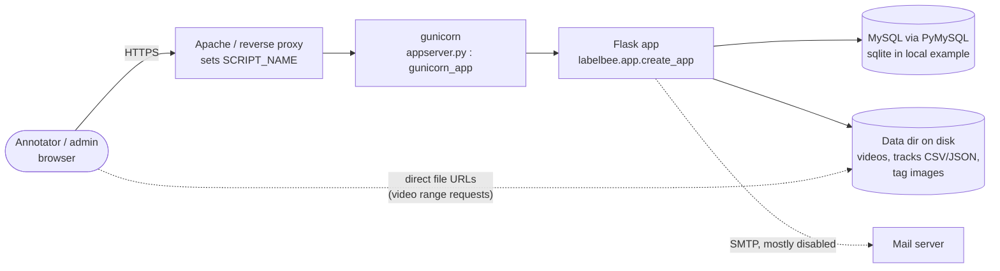
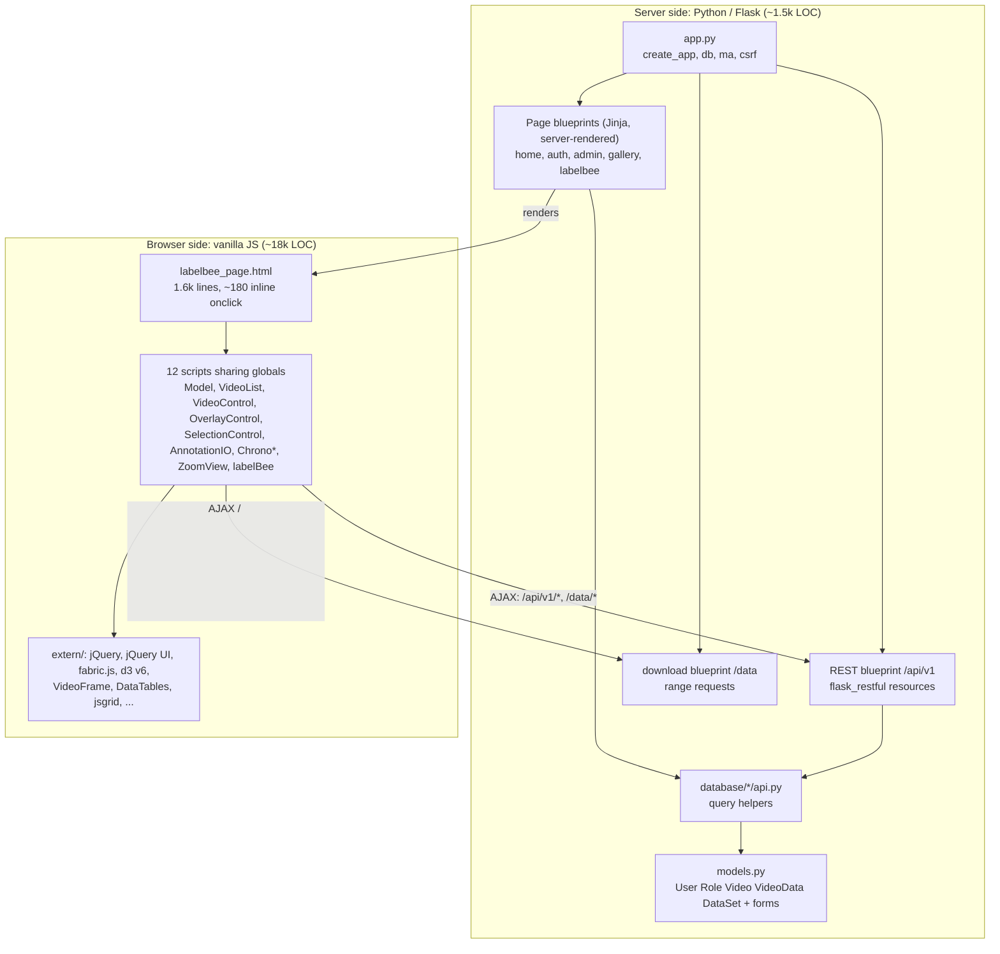
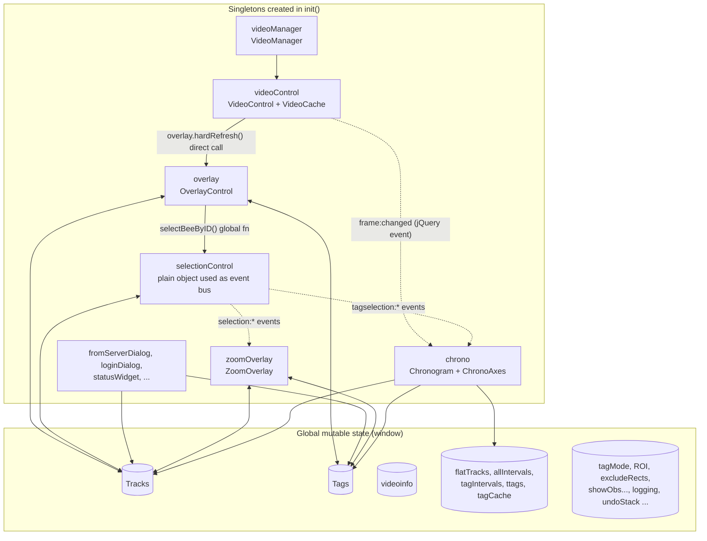

# Stage 1: General architecture

## 1.1 System context

- `ReverseProxied` middleware (`labelbee/middlewares/reverse_proxy.py`) lets the
  app live under a prefix. The prefix is passed to JS as `http_script_name`
  and re-applied by `url_for()` in `labelBee.js`.
- Two *different* roots for data on disk (see 2.5): `static/data` (download
  blueprint) and `$DATA_DIR` (rawdata API).
- Deployment assets: `gunicorn_*.sh`, `Procfile` (points to nonexistent
  `manage:app`), `Dockerfile` + `docker-compose.yaml` (**MySQL only**, not
  the app), `README_deployment.md`.

## 1.2 Two programs in one repository

The only server-to-client contract is: (1) the HTML page rendered by
`blueprints/labelbee/labelbee.py` (passes `userid`, `http_script_name`;
`video_url`/`tag_file` are passed but **not used by the JS**), (2) the JSON
under `/api/v1`, (3) raw files under `/data` and `/api/v1/rawdata/`.

## 1.3 Server route map

| Blueprint | Prefix | Role | Auth |
|-----------|--------|------|------|
| `home` | `/` | landing page | public |
| `auth` | `/user`, `/user/profile` | profile (Flask-User supplies login/register) | login |
| `admin` | `/admin`, `/manage_users`, `/admin/version` | user admin | role `admin` |
| `gallery` | `/datasets`, `/add_dataset`, `/delete_dataset`*, `/edit_dataset`*, `/videos`, `/edit_video`*, `/videodata`, `/video_data_details` | HTML CRUD on datasets / videos / annotations | login; `*` = role `admin` |
| `labelbee` | `/labelbee/gui` | **the annotator page** | login |
| `download` | `/data/<path>` | static data with HTTP range | **none seen** (unverified) |
| `api` | `/api/v1/...` | JSON: videos, datasets, annotations, auth, rawdata | per-method `current_user` checks, CSRF-exempt |

## 1.4 Client runtime architecture (as is)

Reading guide: **solid** arrows are direct calls through globals, **dotted**
arrows are the jQuery events. There is no central store, no module system,
and no layering: the "model" (`Model.js`, 293 lines) is tiny and everything
else reads/writes `Tracks` and `Tags` directly.

## 1.5 Layers that are *missing* (what the refactor would introduce)

1. A real **model/store** owning `Tracks`/`Tags`/selection with change events.
2. A **service layer** for server I/O (today `$.ajax` calls are spread across
   `AnnotationIO`, `VideoList`, `VideoControl`, `ZoomView`, `labelBee`).
3. **Views** separated from controllers (today canvas drawing, form updates
   and data mutation live in the same functions).
4. A **module system** (ES modules) so dependencies are explicit.
