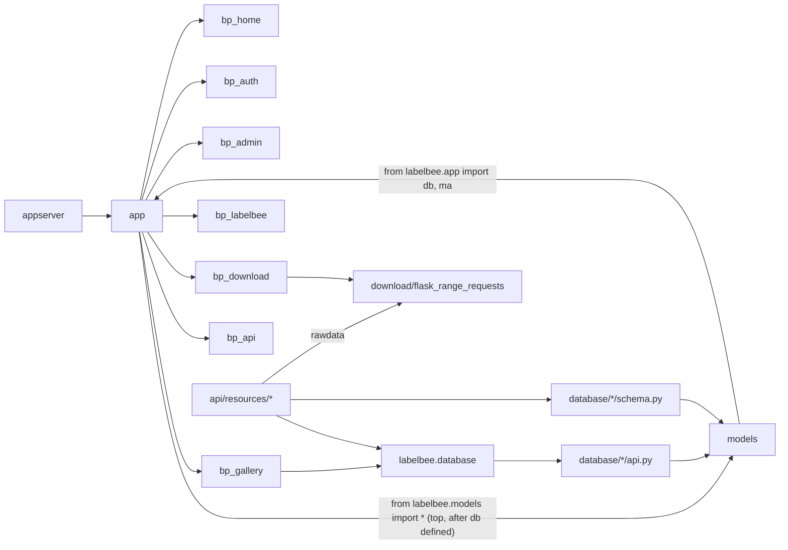
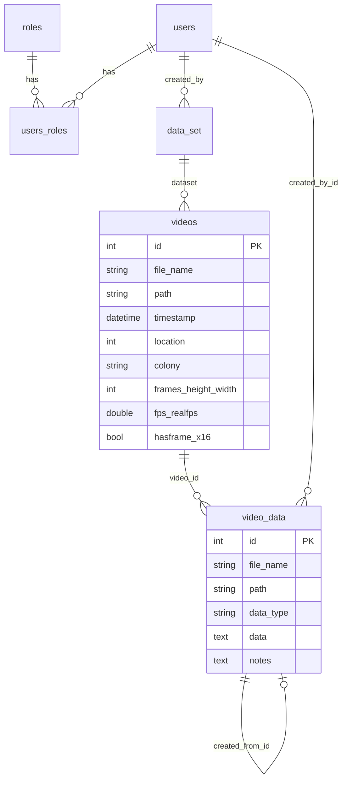

# Stage 2: Backend

## 2.1 Package layout

```
appserver.py                 gunicorn entry: create_app()
labelbee/app.py              app factory + module-level db / ma / csrf
labelbee/models.py           ALL models + WTForms forms + CustomUserManager
labelbee/settings/           settings.py (common), local_settings.py (TRACKED, env-driven)
labelbee/middlewares/        ReverseProxied
labelbee/blueprints/         home auth admin gallery labelbee download api (+ shared templates/)
labelbee/database/<x>/       api.py (query helpers), schema.py (marshmallow), model.py (duplicate, see 2.4)
labelbee/legacy/views.py     old code; only referenced from a comment
```

## 2.2 Import / dependency graph (Python)



`app.py` <-> `models.py` is a **circular import** that works only because `db`
is defined before `from labelbee.models import *`. Blueprints and `database/*`
also do `from labelbee.app import db`, so everything depends on the app module.

## 2.3 Application factory (`create_app`)

Order of operations, with notes:

1. `Flask(__name__, static_url_path="")` -> static files served from site root.
2. Wrap WSGI in `ReverseProxied`.
3. Logging: removes handler 0, requires `LABELBEE_LOGDIR` (crashes with
   `TypeError` if unset, since `os.makedirs(None)`).
4. Config: `settings.settings` then `settings.local_settings` (the latter is
   committed and reads env vars; `exit(...)` on ImportError).
5. `ma = Marshmallow(app)` **shadows** the module-level `ma`, followed by
   `ma.init_app(app)` on the local one (module-level `ma` is never initialised
   with the app through this path; works because flask-marshmallow tolerates it,
   **(unverified)**).
6. `db.init_app`, `Migrate`, `csrf.init_app`.
7. Register 7 blueprints; `csrf.exempt(api.bp)`.
8. `UserManager(app, db, User)` **after** blueprints; `CustomUserManager` /
   `MyRegisterForm` in `models.py` are therefore *unused*.
9. `logger.info("config=%s", app.config)` logs the **entire config incl.
   SECRET_KEY / DB URI with password** to the log file.

## 2.4 Data model



- `video_data.data` stores the annotation payload (JSON text) for
  `data_type` in {tracks/events, tags, ...} **(values unverified: need DB sample)**.
- `Video` has ~10 `hasframe*` booleans flagged `adhoc` by TODOs.
- `VideoData.created_from_id` is the "derived from" lineage (a TODO calls it
  "Terrible"); no ORM relationship.
- `users_roles` is a hand-written association *model* (TODO asks why).
- **Duplicate definitions**: `database/annotation/model.py` re-declares
  `VideoData` (same `__tablename__`). It is not imported by
  `database/__init__.py`, so probably dead **(unverified: grep other imports)**.
  Other `database/*/model.py` likely the same.

## 2.5 REST API (`/api/v1`, flask_restful)

| Resource | Endpoints | Notes |
|----------|-----------|-------|
| `Login/Logout/Whoami` | `POST /auth/login`, `POST /auth/logout`, `GET /auth/whoami` | `Login.get` actually *logs out*; returns CSRF token |
| `VideoListAPI / VideoAPI` | `/videos`, `/video/<id>` | POST uploads a video, reads it with OpenCV, writes to `$ROOT_PATH` |
| `DatasetListAPI / DatasetAPI` | `/datasets`, `/dataset/<id>` | |
| `AnnotationsAPI` | `GET/POST /annotations` | main persistence for tracks & tags |
| `AnnotationAPI` | `GET/PUT/DELETE /annotation/<id>` | PUT admin only |
| `RawDataAPI` | `/rawdata/`, `/rawdata/<path>` | directory listing + file serving under `$DATA_DIR` |

Uniform-ish envelope `{success, status_code, data}` except auth (`status`),
rawdata (HTML or `{status,message,code}`), and errors returned with HTTP 200.

Pattern repeated per method: manual `if not current_user.is_authenticated:
abort(401)`; no decorator, no schema-level validation of query args.

## 2.6 What the browser actually calls (from JS grep)

`/api/v1/auth/{login,logout,whoami}`, `/api/v1/annotations` (list recent,
advanced list, POST save), `/api/v1/annotation/<id>` (load by id),
`/api/v1/rawdata/<path>` (file pickers), `/data/<path>` (videos, tag images,
hamming matrices), plus `rest/v2/annotation/<id>` and `rest/v2/videodata` in
**dead or commented code** (a previous API version).

## 2.7 Test & tooling state

- `tests/conftest.py` imports `labelbee.init_app` and `labelbee.manage_commands`:
  **neither exists** -> suite cannot even collect. `test_page_urls.py` targets
  old endpoint names (`home_page`, `user_page` unqualified; no blueprint prefix)
  and fixtures (`user@example.com`).
- `tox.ini`, `Procfile` (`manage:app`), root `README.md` (`manage.py`,
  `runtests.sh`) and `labelbee/README.md` describe a previous layout.
- `requirements.txt` pins Flask 3.0.3 but also Flask-Script, Flask-Security-Too,
  Flask-Principal, numpy, opencv (heavy; used only by video upload).
