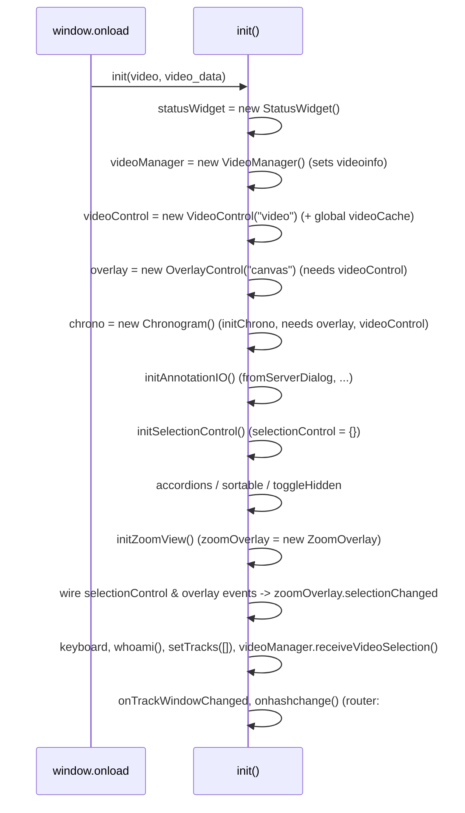

# Stage 3: Frontend structure

Location: `labelbee/static/labelbee/js/`. Page: `labelbee/blueprints/labelbee/templates/labelbee_page.html`.
The page is served at `/labelbee/gui`, so the relative URLs `js/...`, `css/...`
resolve to `static/labelbee/...` (this is why `static/labelbee/` exists next to
`static/{css,fonts,images}`; the latter pair appears to serve the other pages)
**(inferred)**.

## 3.1 Inventory

| File | LOC | Style | Role |
|------|----:|-------|------|
| `OverlayControl.js` | 4564 | ctor + ~40 prototype methods + ~100 free functions | Canvas overlay (fabric.js): draw video frame, rectangles, tags, tracks, ROI, exclude rects; mouse interaction; ID prediction; timeline & visit widgets |
| `ZoomView.js` | 2337 | ctor + ~70 prototype methods + free fns | Zoom window on selected bee: keypoint "parts", tag decoding/Hamming view, tag fixes ("bake") |
| `AnnotationIO.js` | 2098 | ~80 free functions + 5 "Dialog" ctors | Load/save tracks & tags (JSON v1/v2, CSV, tracks_tagged, server), login, format sanitising/conversion |
| `ChronoControl.js` | 2021 | `class Chronogram` + ~70 free fns | Timeline (d3): data preparation (flatten, intervals), axes, selection, obs table |
| `VideoControl.js` | 1337 | ctor + prototype; `VideoCache` | Video element, frame-exact seek (VideoFrame lib), play, preview video, frame cache |
| `SelectionControl.js` | 1040 | free fns | Selected bee + form panel, labels, undo stack, ID swap |
| `ChronoAxes.js` | 1040 | one function `ChronoAxes` (closure) | d3 axes/zoom/brush for chronogram |
| `labelBee.js` | 948 | free fns | `init()`, hash router, keyboard, `StatusWidget`, `FilePickerFromServerDialog`, `url_for` |
| `VideoList.js` | 849 | ctor + prototype | `VideoManager`: video list (CSV/JSON/server/DB), selection, loading |
| `ChronoControlActivitiesLegacy.js` | 808 | free fns | Old d3 activity drawing; behind `chrono.config.legacyActivities` |
| `ChronoControlInteraction.js` | 513 | free fns | "Go to next/previous event/ID" navigation |
| `Model.js` | 293 | free fns | `Observation`, `Tracks`/`Tags` accessors, ID change/swap |
| `DuckDB.js`, `SQLiteDB.js` | 150, 75 | ES modules | Experiments; **commented out in the page** |

External (vendored, do not touch): jQuery + jQuery UI 1.12.1, DataTables,
Bootstrap 3, jsgrid 1.5.3, fabric.js, d3 v6, VideoFrame, lru_cache,
ResizeSensor, jquery.csv, perspective-transform. (`extern/` also holds
`require.js`, `main.js`, `fabric.canvasex.js`, `bootstrap.min.js` that the
page does not load.)

## 3.2 Load order and bootstrap

`<script>` tags in this order (no `defer`/`type=module`), dependencies implied
by order only:

`Model -> VideoList -> VideoControl -> OverlayControl -> SelectionControl ->
AnnotationIO -> ChronoAxes -> ChronoControl -> ChronoControlActivitiesLegacy ->
ChronoControlInteraction -> ZoomView -> labelBee`

then `window.onload = () => init($_GET.video, $_GET.video_data)` (query
params parsed by an inline script in the page; **`init` ignores both
arguments** except for logging).

Hidden constraints in this order: `OverlayControl` ctor reads `videoControl`
and `videoinfo`; `Chronogram` ctor reads `overlay`; `ZoomOverlay` ctor reads
`selectionControl`; constructing out of order throws.

## 3.3 Global symbols (implicit)

Created without `var/let/const` (so they are properties of `window`; strict
mode would break them): `videoControl, overlay, chrono, zoomOverlay,
videoManager, selectionControl, statusWidget, fromServerDialog, loginDialog,
labelListDialog, videoCache, videoinfo, getCurrentFrame, http_script_name,
change_id_force, lasthash, onhashchange, ROI, flag_useROI, excludeRects,
showObs*, showTags*, transformFactor, canvasTransform, lockFocusTrackWindow,
tagCache, ttags, TracksInfo, TagsInfo, tagsHaveDM, videoListTable,
videoListCurrentID, labelButtonsArray, ...` plus 381 top-level `function` declarations
(all callable from the 180 inline `onclick=` handlers).

## 3.4 Coupling matrix (word occurrences of a global inside each file)

Rows: the symbol. Columns: the file *using* it. Higher = tighter coupling.
(Counts from grep; includes comments; a rough signal, not exact.)

| symbol | Overlay | Zoom | AnnotationIO | Chrono* | Selection | VideoControl | VideoList | labelBee |
|--------|--------:|-----:|-------------:|--------:|----------:|-------------:|----------:|---------:|
| `videoControl` | 78 | 8 | 10 | 33 | 9 | 43 (self) | 5 | 21 |
| `overlay` | 401 (self) | 21 | - | 10 | 19 | 6 | - | 8 |
| `zoomOverlay` | 9 | 91 (self) | - | - | - | 1 | - | 8 |
| `chrono` | - | - | - | 59 (self) | - | 1 | - | 2 |
| `videoManager` | - | - | 6 | - | - | 3 | 32 (self) | 5 |
| `selectionControl` | - | - | - | 3 | 20 (self) | - | - | 2 |
| `statusWidget` | - | 1 | 3 | - | - | 15 | 3 | 1 |
| `fromServerDialog` | - | - | 14 (self) | - | - | 3 | 18 | - |
| `Tracks` | 6 | 16 | 40 | 31 | 4 | - | - | 1 |
| `Tags` | 9 | 9 | 26 | 19 | 1 | - | 1 | - |
| `tagIntervals` / `allIntervals` / `flatTracks` | - | - | - | ~55 | - | - | - | - |

Take-aways:
- `videoControl` is read by *every* module; `overlay` by Selection, Zoom,
  Chrono and VideoControl (so VideoControl <-> OverlayControl is a **cycle**:
  `VideoControl.refresh()` calls `overlay.hardRefresh()`;
  `OverlayControl` listens to `videoControl` events and calls
  `videoControl.getCurrentFrame/seek...`).
- `Tracks`/`Tags` are touched by 6 files; `AnnotationIO` (replace wholesale),
  `Model` (CRUD), `Overlay` (edit on drag/draw), `Selection` (form edits,
  undo), `Zoom` (parts, tag fixes), `Chrono` (reads, and *augments*
  Tracks from Tags, see Stage 4).
- `ChronoControl*` owns 6 derived globals shared by 3 files.

## 3.5 Event bus (jQuery events on plain objects)

| Emitter (target) | Event | Listeners |
|------------------|-------|-----------|
| `videoControl` | `frame:changed` | `updateTimeMark`, `updateTrackWindowSpan`, `overlay` (`trackWindow:change` re-trigger), `gotoEvent_seekCB` |
| `videoControl` | `previewframe:changed` | chrono preview mark, trackWindow |
| `videoControl` | `video:loaded` | (listener commented in Overlay) |
| `videoControl` | `videosize:changed` | `overlay.canvasSetVideoSize` |
| `overlay` | `trackWindow:change` | `updateTrackWindowSpan`, `focusTrackWindow` |
| `overlay` | `object:moving`, `object:modified` | `zoomOverlay.selectionChanged` |
| `selectionControl` | `tagselection:created/cleared` | `updateChronoSelection`, `updateSelectID`, `updateFormButtons`, `zoomOverlay.selectionChanged` |
| `selectionControl` | `selection:created/cleared` | `updateFormButtons`, `zoomOverlay.selectionChanged` |
| `selectionControl` | `before:selection:cleared` | none found |
| `axes` (ChronoAxes) | `previewframe:trackmove`, `previewframe:trackend` | `onAxesMoved`, `endPreview`, `updateTrackWindowSpan` |

Everything else is **direct calls**: e.g. `VideoControl.refresh()` ->
`overlay.hardRefresh()`; `setTracks()` -> `videoControl.onFrameChanged()` +
`refreshChronogram()`; `OverlayControl` -> `selectBeeByID()` (Selection),
`refreshChronogram()`, `gotoEvent()`. Comments such as
"Zoom Overlay supposed to be updated by triggers from overlay refresh" show
that update order is partly implicit and was a source of bugs.

## 3.6 HTML <-> JS coupling

`labelbee_page.html` (1627 lines): 180 inline `onclick=` calls, top ones:
`overlay.optsClick` (18), `onLabelToggled` (8), `modifyCurrentObsSpan` (7),
`chronoFilter` / `chronoAdjust` (6 each), many `zoomOverlay.*`. Also hard-coded
element ids (`#chronoTab`, `#svgVisualize`, `#canvasresize`, `#zoomresize`, ...)
referenced from the JS constructors (`TODO: fix direct access to #chronoTab`),
and "state in DOM" (button `checked`/`active` classes read back as model, see
the `TODO: Clean up variable<->buttons binding mechanism` in `init`).
