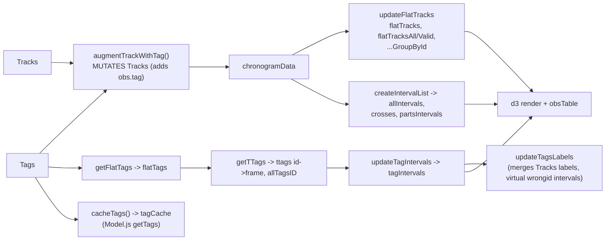

# Stage 4: Client data model

The annotation data is the heart of the app. It lives in **two global
objects** (`Tracks`, `Tags`) plus ~8 derived globals.

## 4.1 Core structures

```mermaid
classDiagram
    class Tracks {
        <<global object, sparse>>
        indexed by frame then id
        frame keys are strings of ints
        ids are STRINGS
    }
    class Observation {
        ID : string
        frame : int
        time
        x y width height : box in video px
        cx cy : center (redundant with x,y,w,h)
        angle : deg
        bool_acts : 4 flags fanning pollen entering leaving (redundant with labels)
        labels : "a,b,c" string
        notes : string
        parts? : [{posFrame{x,y}, label}]
        newid? : for wrongid
        fix? : tag fix info
        visit? : pollination visit
        span? : {f1,f2}
        tag? : Tag   (ADDED by chrono, not saved)
    }
    class Tags {
        <<global object>>
        indexed by frame
        each frame has a tags list
    }
    class Tag {
        id : int
        frame : int (added by tagsAddFrames)
        c : [x,y]
        p : 4 corners
        hamming
        goodness
        dm?
    }
    Tracks --> Observation
    Tags --> Tag
    Observation ..> Tag : "obs.tag, if same (frame,id)"
```

- `Observation` is a plain constructor, but loaded data are plain objects
  (not `Observation` instances); `copyObs` copies a **fixed field list**, so any
  new field (`span`, `visit`, `fix`, `parts`, `newid`) must be added by hand
  there or it is lost on edit. `labels` and `bool_acts` encode the same facts
  twice and must be kept in sync (`updateLabelsFromBool`, `sanitizeEvents`).
- Two ID spaces: tag ids (ints) and track/obs ids (strings, `T<n>` for
  untagged tracks in `tracks_tagged` CSV).
- Metadata: `TracksInfo`, `TagsInfo` (`{type, source, history, notes...}`),
  `videoinfo` (name, fps, nframes, start time, preview URLs, frame offset).
- `tagMode` (`OverlayControl.js:5`, value `'Tracks'`) selects whether tags come
  from `Tags` or embedded in `Tracks` (`obs.tag`), see last commit
  `35224264`. Read in Overlay and Chrono (3 uses each).

## 4.2 Derived data (rebuilt on every `refreshChronogram`)



Everything is recomputed from scratch (O(frames x ids)) on each edit that
calls `refreshChronogram()`. The `chrono.perf` object measures it; no
incremental update exists.

## 4.3 Who writes what

| Writer | Writes | How |
|--------|--------|-----|
| `AnnotationIO.setTracks/setTags` | replaces `Tracks`/`Tags` wholesale (after `sanitizeEvents`) | assignment to global |
| `Model.storeObs/getObsHandle(create)` | single observation | `copyObs` |
| `Model.changeObservationID/obs_swapID` | ID reassignment, may swap | mutate `Tracks` |
| `OverlayControl` mouse handlers (`onObjectModified`, `onMouseDown_*`) | geometry, new obs, delete | via rect <-> obs sync (`updateRectObsGeometry`) |
| `SelectionControl.submit_bee/labelToggle/deleteSelected/undo` | fields, labels, delete | direct on `Tracks` + `undoStack` |
| `ZoomOverlay` | `obs.parts`, tag fixes (`bakeTagFix` edits `Tags`) | direct |
| `ChronoControl.augmentTrackWithTag` | `obs.tag` | direct (read path mutates!) |
| `cleanObsoleteEvents` (button `cleanObsoleteEventsButton`) | deletes obs | direct, confirm() only, no undo |
| `overlay.hardRefresh` (pick-frame mode) | `obs.span` | "poke directly" (comment) |

No change events exist for the model: each writer is responsible for calling
the right combination of `videoControl.refresh()`, `overlay.hardRefresh()`,
`refreshChronogram()`, `updateAnnotationStatistics()`. Forgetting one gives
stale views; this is the main bug source (several "supposed to be updated by
trigger" comments).

## 4.4 File formats (client I/O in `AnnotationIO.js`)

| Format | Read | Write | Notes |
|--------|------|-------|-------|
| Tracks JSON v1 (`obj[frame][id]`) | yes (`sanitizeEvents`) | `convertTracksToV1` | legacy |
| Tracks JSON v2 `{info:{type:"events-multiframe"}, data}` | yes | `convertTracksToV2` | current; duplicate ids per frame dropped with alert |
| Tags JSON v1/v2 `{info:{type:"tags-multiframe"}, data}` | `setTags` | `saveTagsToFile` | |
| Tracks CSV | `tracks_csv_to_json` | `tracksToCSV` | |
| Tags CSV | `tags_csv_to_json`, `tags_csv_to_tagjson` | - | |
| `tracks_tagged` CSV | `tracks_tagged_csv_to_json` | - | hardcoded 300x600 box, `angle+90`, parts head/neck/thorax/waist/tail |
| Bounding boxes | - | `tracksToBBoxes`, `tracksToBBoxes2` | export (YOLO-ish?) **(unverified)** |
| Server DB record | `api/v1/annotation/<id>` | `POST api/v1/annotations` (form fields) | payload stored as text in `video_data.data` |
| SQLite / DuckDB | `loadTracksCSVFromDB` | - | experimental, scripts disabled in page |

Seven JS functions parse formats; there is no schema/validator and no
version field consistency (`info.type` only).

## 4.5 Concrete defects seen in this layer (details in Stage 6)

- `convertTracksToV1`: `Object.assign(evt)` has one argument -> returns the
  same object, then **deletes fields and rounds x/y/w/h on live `Tracks`**
  while "just saving".
- `cacheTags`: tests `typeof ttags[key]` instead of `tagCache[key]` (works
  only if the first branch is always taken) **(unverified use)**.
- `setTags` v1 branch validates `Object.keys(Tags)` (the *old global*), not
  the incoming `obj`; also uses bitwise `&` between booleans.
- `sanitizeEvents`: `typeof obj == "array"` is never true.
- `ZoomOverlay.bakeTagFix(obs)` with no argument does `let obs = activeObject.obs`
  inside the `if` block: this **shadows** the parameter, so the outer `obs`
  stays `undefined` and the function then throws at `hasLabel(obs, ...)`.
  `for (k in tags)` also leaks a global `k`.
- `getValidIDsForFrame` iterates `for..in` (string keys, order = insertion).
