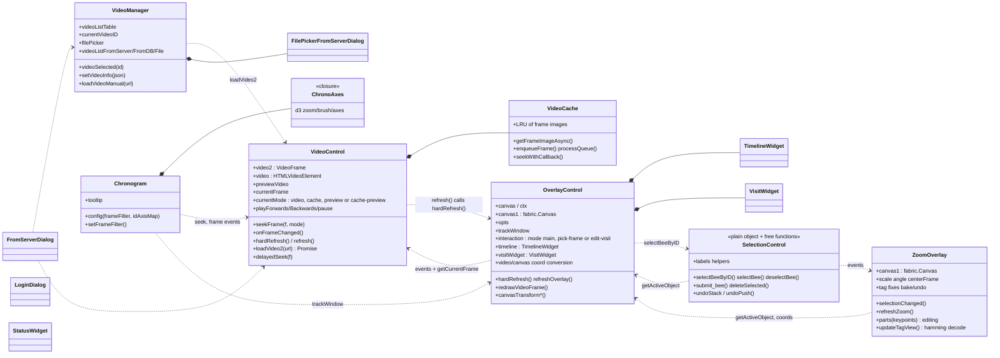
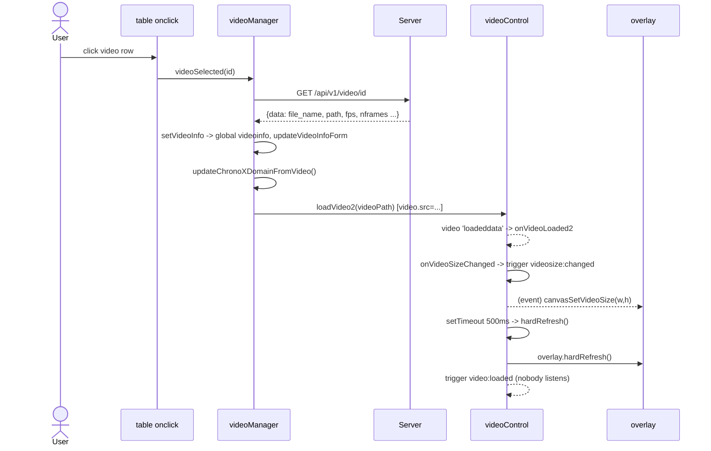
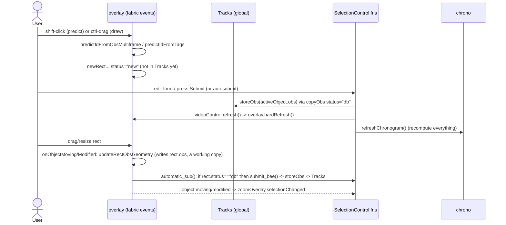

# Stage 5: Classes, modules and interactions

## 5.1 Class / module diagram (frontend, as is)



Dotted arrows are the dependencies actually found by grep. Note the **two
cycles**: VideoControl <-> OverlayControl, and Overlay <-> Selection <-> Zoom.

## 5.2 Module-by-module notes

### `Model.js` (293 lines)
Pure-ish logic, the best candidate for first extraction/testing:
`Observation`, `copyObs/cloneObs`, `getValidIDsForFrame(s)`, `obsDoesExist`,
`getObsHandle(create)`, `storeObs`, `changeObservationID(force: false|true|'swap')`,
`getFramesWithID`, `obs_swapID`, `cacheTags/getTags`. Depends only on globals
`Tracks`, `Tags`, `ttags`, `logging`. (`obs_swapID` uses `Tracks` and
`getFramesWithSwapID`; untested.)

### `VideoList.js` -> `VideoManager`
Owns the list of videos (from CSV/JSON file, `/data/videolist.csv`, server DB
`/api/v1/videos`, or manual URL) and the `videoinfo` global. Sets
`videoinfo` twice (ctor placeholder, `setVideoInfo`). `videoSelected(id)`:
GET `/api/v1/video/<id>` -> `setVideoInfo` -> `videoControl.loadVideo2()`.
Defects: `selectVideoBy_video_id` does not `await`/return `videoSelected`, so the
router's "videoSelected SUCCESS" log is premature; the ajax `error` callback
`throw`s inside a callback (unhandled, promise never settles).

### `VideoControl.js` -> `VideoControl`, `VideoCache`
Frame-exact seeking via the `VideoFrame` library on top of `<video>`; four
display modes (`video`, `cache`, `preview`, `cache-preview`); `VideoCache`
decodes frames to images (LRU) for scrubbing. `onFrameChanged` is the single
funnel for frame change; it also contains **hash-router code**
(`removeHashOnFrameChange`, `lasthash`, add/remove `hashchange` listener),
a concern that belongs to `labelBee.js`. `onVideoLoaded2` clears
`delayedSeekFrame` and then seeks to `this.delayedSeekFrame` (now `undefined`)
inside `setTimeout`: the delayed seek from `#frame=` cannot work as written
**(unverified at runtime)**; a `500 ms` timer papers over a first-frame-blank bug.
Writes global `videoCache`; `loadVideo` (old) is marked DEPRECATED.

### `OverlayControl.js` (4564 lines): split by *kind*, not by file
| Lines | Concern | Entry points |
|------:|---------|--------------|
| 7-250 | ctor, option state, interaction modes | `OverlayControl`, `setInteractionMode` |
| 250-730 | `TimelineWidget`, `VisitWidget` (pollination visits) | `open`, `newVisit`, ... |
| 730-1200 | options UI, canvas size/transform, coordinate conversions | `canvasTransform*`, `*ToCanvas*` |
| 1185-1500 | crop/timeline image drawing, pick-flower | `getFrameCropImg`, `drawTimeline*` |
| 1506-1920 | `hardRefresh` (includes pick-frame UI built as HTML strings), video frame drawing incl. image diff & cache | `redrawVideoFrame*` |
| 1928-2560 | rect <-> obs sync, ID display, `identify` | `createRectsFromTracks`, `addRectFromObs`, `rotatedRectGeometry` |
| 2563-3130 | **plotting** tracks, tags, tag tracks (canvas `ctx`) | `plotTracks`, `plotTags`, `plotTagsTracks` |
| 3130-3510 | track window, ROI, exclude rects (+dialog) | `setTrackWindow`, `plotROI`, `plotExcludeRects` |
| 3508-3910 | tag parameters, **ID prediction** (pure-ish geometry) | `predictId*`, `computeDefaultNewID` |
| 3912-4564 | **mouse/keyboard interaction**: create, drag, select, pan, wheel | `onMouseDown*`, `onObject*` |

The "class" holds options/state, but ~100 free functions use the global
`overlay`. Hard-coded Gurabo defaults (`ROI`, four `excludeRects`) live in the
constructor.

### `SelectionControl.js`
"Selection" is distributed across 3 places: fabric's active object (truth
for *which rect*), `defaultSelectedBee` (survives frame change; re-selects ID
in the next frame), `tagSelection`. Also hosts: the labels vocabulary
(`labelMap`, `labelButtonsArray`), label string helpers, the **undo stack**
(`undoPush(action, info)`), `modifyCurrentObsSpan`, `updateAnnotationStatistics`.

### `AnnotationIO.js`
Five concerns in one file: (1) auth (`ajaxlogin`, `LoginDialog`, `whoami`),
(2) local file load/save, (3) server list/load/save dialogs
(`FromServerDialog`, `LabelListFromServerDialog`), (4) format parsing
(`sanitizeEvents`, CSV converters, `tracks_tagged_csv_to_json`), (5) DB
(DuckDB/SQLite) experiments. `eventsToServer` posts the **whole** `Tracks` as
a JSON string in a form field with `created_by_id: user_id` taken from the
client.

### `ChronoControl.js`, `ChronoAxes.js`, `ChronoControlInteraction.js`, `...Legacy.js`
`Chronogram` (class) is a thin shell (config, frame filter, tooltip,
`initChrono()`); all the behaviour is the ~70 free functions below it:
view layer (`ChronoAxes` d3), data preparation (see 4.2), navigation
(`gotoNext/PreviousEvent`, `findNext*`), and the old renderer
(`...Legacy.js`, off by default; duplicates `createIntervalList`).
`ChronoControl.js` uses section "markers" (`var __section__...`) as
poor-man's regions; a memo (`MEMO_refactoring_chronogram.txt`) maps the call tree.

### `ZoomView.js` -> `ZoomOverlay`
Zoom window synchronised with the active rect: draws crop, grid, keypoints
("parts") editable via a second fabric canvas, tag view (decodes the 5x5 bit
pattern, Hamming search against `tag25h5` code table fetched from
`/data/tags/tag25h5inv/...`), distractor tags, tag "fix" workflow
(rotate/reassign id, `bake` into `Tags`). Mixes UI, geometry, tag decoding
algorithms (`hamming`, `findBestHamming`, `rotateTagBin`, `extractTagBin`;
all pure) and data mutation.

### `labelBee.js`
`init()`, global `logging` flags, hash router (`#video_id=&video_data=&frame=`),
`StatusWidget`, `FilePickerFromServerDialog` (generic dir browser over
`/api/v1/rawdata/`), `url_for`, `pathJoin`, keyboard handlers
(`onKeyDown`, `onKeyDown_IDEdit`, ...).

## 5.3 Key scenarios (sequence diagrams)

### A. Load a video from the DB and seek



### B. Frame change -> every view refreshed

```mermaid
sequenceDiagram
    participant X as seek / play / key / chrono click
    participant VC as videoControl
    participant OV as overlay
    participant SEL as selection (global fns + events)
    participant ZO as zoomOverlay
    participant CH as chrono
    X->>VC: seekFrame(f)
    VC->>VC: video2.seekTo -> callback onFrameChangedVideo2
    VC->>VC: onFrameChanged()
    VC->>VC: hardRefresh() -> refresh()
    VC->>VC: updateVideoControlForm() (DOM)
    VC->>OV: hardRefresh()
    OV->>OV: redrawVideoFrame(); canvas1.clear(); createRectsFromTracks()
    OV->>SEL: selectBeeByID(defaultSelectedBee)
    SEL->>SEL: updateForm(rect)
    SEL-->>ZO: tagselection/selection events -> selectionChanged -> refreshZoom
    OV->>OV: refreshOverlay(): plotTracks, plotTags, plotROI, plotExcludeRects
    VC-->>CH: trigger frame:changed
    CH->>CH: updateTimeMark, updateTrackWindowSpan
    CH-->>OV: (re-trigger) trackWindow:change -> focusTrackWindow
```

### C. Create / edit an annotation



### D. Save to / load from server

```mermaid
sequenceDiagram
    participant UI as Save button / Load dialog
    participant IO as AnnotationIO
    participant S as /api/v1
    UI->>IO: eventsToServer()
    IO->>IO: convertTracksToV2() [mutates Tracks, see 4.5]
    IO->>S: POST /annotations {video_id, created_by_id(client), data_type:"event", data: JSON string}
    S->>S: add_video_data(created_by = user looked up from created_by_id)
    S-->>IO: {data:{id,file_name,path,...}} -> alert()
    UI->>IO: tracksListFromServer / loadEventsFromServerByID(id)
    IO->>S: GET /annotation/id
    S-->>IO: {data: {data: "<json string>", ...}}
    IO->>IO: JSON.parse -> setTracks() -> sanitizeEvents()
    IO->>IO: videoControl.onFrameChanged(); refreshChronogram()  (done twice: setTracks also does it)
    Note over IO: loadEventsFromServerByID (the #video_data= route) then reads<br/>undefined names tag_event_ID, theDialog, div (copy-paste from FromServerDialog.loadEvents)<br/>and returns before the ajax completes
```

## 5.4 Interaction summary: what a refactor must preserve

1. `frame:changed` ordering: overlay first (direct call), chrono second (event).
2. `defaultSelectedBee` re-selection after each redraw (selection follows the
   ID across frames).
3. After any data mutation: refresh overlay and chrono (`refreshChronogram`
   is expensive and global).
4. Keyboard focus lives on `#left-side` (tabindex=0); `onKeyDown` is a router
   to sub-handlers (ID edit, new ID edit, zoom overlay).
5. Hash router semantics (`#video_id`, `#video_data`, `#frame`) are a public
   deep-link contract (links are generated in `updateVideoControlForm`).
