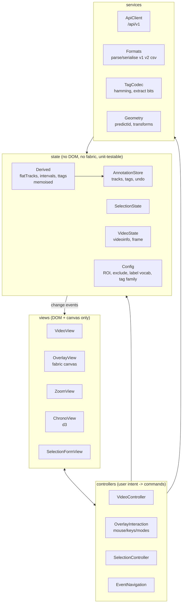

# Stage 7: Questions and proposals

Read stages 1-6 first. This document is the only place where I ask for
decisions. Each question has a **default** I will use if you do not answer, so
nothing blocks. Q-ids are referenced from the proposals.

## A. Questions for you

### A1. Scope and priorities

| Id | Question | Why it matters | My default |
|----|----------|----------------|------------|
| Q1 | Is the target the **annotator front-end only**, or also the Flask backend? | Front-end is ~92% of the code and the risk; backend needs hygiene, not a redesign | Front-end first; backend only for items in Q5/Q6 |
| Q2 | What is the **end state** for the JS: (a) ES modules + same libs (jQuery, fabric, d3), (b) + a bundler (Vite/esbuild) + TypeScript/JSDoc types, (c) a framework (Vue/React/Svelte)? | Determines every ADR | (a), JSDoc types checked by `tsc --checkJs`; **no framework, no bundler required** at first |
| Q3 | Which libraries are frozen? `extern/` is vendored (jQuery UI 1.12, Bootstrap 3, fabric.js version?, d3 v6). May they be upgraded or replaced (e.g. via npm)? | Upgrading fabric (old `deactivateAll`, `object:selected` API) is a hidden big step | Frozen. No upgrades during the refactor |
| Q4 | Who uses the app and which features are **in use** today? In particular: pollination `VisitWidget`/pick-frame, tag fixes (`bake`), keypoint parts, `tracks_tagged` CSV, legacy chrono, DuckDB/SQLite, "preview"/"cache" video modes, `/videos` gallery pages | Decides what to delete vs characterise; ~25% of the JS may be dead | Treat everything reachable from the page buttons as live; propose deletions in a separate list for your approval |

### A2. Behaviour and data

| Id | Question | My default |
|----|----------|------------|
| Q5 | Bugs in 6.1/6.2 (e.g. C1 save mutates `Tracks`, C3 delayed seek, S4 `created_by_id`): fix them **first as separate commits**, or keep them until the structural step that naturally replaces them? ("behaviour-preserving" vs. "correct") | List them in `PLAN.md` as *pre-refactor fixes*; do the 3-4 that corrupt data (C1, S4, S3, S1) first, each as its own small step with your OK |
| Q6 | Security items S1-S9: may I touch backend code/config (and `.gitignore`) as part of this effort? The committed mail password (S1) should be rotated by its owner regardless of code changes | Report only; no change until you confirm |
| Q7 | What is the **canonical saved format**? Is JSON v2 (`events-multiframe`) the only one to keep writing? Are v1 and tracks/tags CSV needed for reading only? Is `tracks_tagged` CSV a long-term input? | Keep all readers, write v2 only |
| Q8 | Existing stored data: can I get an **anonymised sample** (one video + its tracks v1/v2, tags, `tracks_tagged`) to use as a fixture? Can I be told the real `data_type` values in `video_data`? | Create synthetic fixtures from the code; flag as weaker |
| Q9 | Is the **Gurabo-specific setup** (ROI for 5MP video, 4 exclude rects, 300x600 default box, `tag25h5`) specific to the Gurabo setup, or meant to be configurable per dataset/video? | Move to a config object, same defaults, no UI |
| Q10 | Multi-user semantics: may several people edit the same annotation file concurrently? Today the client keeps everything in memory and POSTs a whole snapshot, with `created_from_id` as lineage. | Out of scope; keep snapshot model |

### A3. Process and environment

| Id | Question | My default |
|----|----------|------------|
| Q11 | Can I run things in the next phases (browser tests, `npm install`, `pytest`) and may I add dev-only tooling (`package.json`, ESLint, Playwright) under `refactor/tests/`? This analysis ran nothing. | Add tooling only under `refactor/`, never in `labelbee/` |
| Q12 | **Branches/worktrees.** `CLAUDE.md` says "work only on branch `refactor`, never commit unless asked". This session is a background job forced into a separate git worktree (branch `worktree-refactor-analysis`), so the analysis files are there and not in your checkout. How do you want them integrated (cherry-pick, copy, or let me work directly on `refactor`)? | I do not commit; you copy or tell me to |
| Q13 | Is there a **staging/production** instance I can compare against, and what browsers must be supported (the code uses `async`, `class`, optional chaining? and Bootstrap 3)? | Latest Chrome/Firefox |
| Q14 | Review cadence: one step = one PR/commit you review? Max size? | One step per commit, <= ~300 changed lines excluding moves |

## B. Proposed target architecture (client)

Rules: views never write `ANN`; `ANN` emits one `changed` event (kind, frames,
ids) that replaces the hand-called refresh sequences (4.3); no global
singletons (dependencies passed in an `app` context object); pure code
(`Formats`, `TagCodec`, `Geometry`, `Model`) has no `$`/DOM/fabric.

## C. Proposed strategy

**Strangler fig, not rewrite.** Keep the page working after every step.

1. **Safety net first** (Phase 2 of `PLAN.md`), before moving a line:
   - Backend: make `pytest` collect (fix `conftest.py` to use `create_app`,
     SQLite in memory) and add 6-8 smoke tests (login, `/api/v1/videos`,
     annotations round-trip, `/labelbee/gui` renders).
   - Frontend pure logic: characterisation tests (Node, `vm`/jsdom, no
     browser) for `Model.js`, `sanitizeEvents` + converters, `labels` helpers,
     `predictId*`, hamming/tag decode, `tracks_tagged_csv_to_json`. Golden
     JSON fixtures: input file -> expected `Tracks`.
   - One Playwright (or manual `CHECKLIST.md`) scenario: load video+tracks,
     step frames, select, edit, save. Needs Q8/Q11.
2. **Cheap structural wins, in this order** (each a separate step; all
   behaviour-preserving):
   1. Add `// @ts-check`/JSDoc types + ESLint (`no-undef`) *as a report only*
      to produce the **real global dependency list** automatically.
   2. Move constants/config out of code (`Config`, Q9) and `logging` flags.
   3. Extract pure modules as ES modules loaded with `type="module"` **plus a
      temporary `window.X = X` bridge** so inline `onclick` and untouched files
      keep working: `Model`, `Formats` (from AnnotationIO), `TagCodec`
      (from ZoomView), `Geometry`/`predict` (from OverlayControl), `labels`.
   4. Replace inline `onclick=` by `data-action` + one dispatcher (mechanical,
      removes the biggest reason for globals).
   5. Introduce `AnnotationStore` with a `changed` event; route the 7
      writers (4.3) through it; replace hand-written refresh sequences.
   6. Split `OverlayControl.js` along the table in 5.2 (plot* -> OverlayRenderer,
      mouse* -> OverlayInteraction, ROI/exclude -> Regions, Timeline/Visit widgets).
   7. Break the VideoControl <-> Overlay cycle (VideoControl emits only events).
   8. Split `AnnotationIO.js` (auth, files, server dialogs, formats) and a
      single `ApiClient`.
   9. Chrono: make `Chronogram` own its data (`allIntervals`, `flatTracks`... ),
      delete the legacy renderer if Q4 confirms.
   10. Retire the bridge, `strict` mode, then consider Q2(b).
3. **Backend hygiene track** (small, independent, after Q1/Q5/Q6):
   fix `conftest`; delete `database/*/model.py` and unused forms; one
   `video_data_list` query builder; `@login_required` decorator for the API
   resources; use `current_user` for `created_by_id`; do not log config;
   unify `static/` duplicates; make `Procfile`, README, `tox.ini` truthful.

### Proposed ADRs (to write *before* implementing, per `CLAUDE.md`)

| ADR | Decision to record | Depends on |
|-----|--------------------|-----------|
| 0001 | JS module system and migration bridge (`type=module` + `window` bridge) | Q2 |
| 0002 | State ownership and the `changed` event contract for `AnnotationStore` | Q2, Q10 |
| 0003 | Test strategy and fixture policy (Node characterisation + one e2e) | Q8, Q11 |
| 0004 | Treatment of known bugs during a behaviour-preserving refactor | Q5 |
| 0005 | Config for dataset-specific constants | Q9 |
| 0006 | Backend: API auth/ownership model and response envelope | Q1, Q6 |
| 0007 | Removal policy for dead code (list + approval) | Q4 |

## D. How the process itself could be improved

1. **Keep a living "global inventory"** generated by ESLint `no-undef` /
   a small script (list of every cross-file symbol and its readers/writers). It
   replaces my grep-based matrix in 3.4 with exact data and tracks progress as
   it shrinks (metric: number of implicit globals; today 381 top-level functions plus dozens of implicit variables).
2. **Metrics per step** in `PLAN.md`: globals count, lines per file, number of
   files touching `Tracks`/`Tags`. Gives a visible gauge for a long refactor.
3. **Characterise before moving**: every extracted module lands with its
   golden-file test in the same step.
4. **Small mechanical steps separated from semantic steps** (move/rename vs.
   change) so diffs are reviewable; use `git mv` and `--color-moved`.
5. **A `CHECKLIST.md` for manual smoke** (20 items: load video, play, seek via
   chrono, select, create by shift-click, edit labels, undo, swap id,
   load/save, zoom tag view, parts) run before each merge until Playwright exists.
6. **Decision log discipline**: link each ADR from `PLAN.md` "Decisions log" and
   each pre-existing bug from 6.x to the step that will fix it.
7. **Background jobs and worktrees**: decide once (Q12) how analysis/work from
   parallel sessions is merged, so notes are not stranded in a throw-away worktree.
8. **Guard rails against drift**: a pre-commit check that nothing is edited
   under `extern/`, `legacy/`, `docs/build/` (already stated as a rule in
   `CLAUDE.md`, but not enforced).

## E. What I need from you to start Phase 2

Minimum: answers to **Q2, Q4, Q5, Q8, Q11, Q12**. Everything else has a default.
